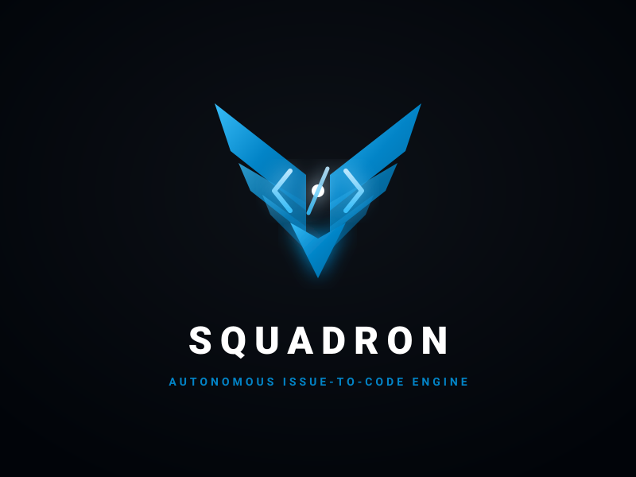

GitHub Actions pipelines for a three-role AI engineering workflow using issue labels, without a GitHub Project dependency.

## Workflow

1. Add `status:todo` to an issue when work should start. This label automatically triggers the coder; no `agent:coder` label is needed on the issue.
2. The coder changes the issue status label to `status:in-progress`, implements the issue, updates relevant documentation, opens a pull request, and queues review with `agent:reviewer`.
3. The reviewer consumes `agent:reviewer` when review starts, checks the code and relevant documentation against the issue, then posts a verdict. A validated pull request changes the issue label to `status:testing` and receives `agent:tester`. A rejected pull request changes the issue label to `status:in-progress` and receives `agent:coder`; after fixing the existing PR, the coder reapplies `agent:reviewer` to queue another review.
4. The tester uses only the issue title and body as its requirements source, not documentation or prior agent summaries. It adds tests under the configured test paths and ensures `SQUADRON_TEST_COMMAND` works (default `npm run test`). If that npm script is missing, it configures `package.json` to invoke the existing test runner or adds a suitable test dependency and updates the lockfile. It does not weaken tests or change product implementation. The workflow installs dependencies, reruns the command after publishing tests, and only merges after it passes. If it fails, the tester reports the output, returns the issue to `status:in-progress`, and queues the coder on the existing PR. After success, it directly squash-merges the PR. Once GitHub merges the pull request, the issue label changes to `status:done`.

The reviewer verdict is posted as a pull request comment; it is not a GitHub approval review. Repository branch protection and required checks remain authoritative.

## Configuration

Create these repository secrets:

- `COPILOT_GITHUB_TOKEN`: a token authorized to use GitHub Copilot. It is only provided to the Copilot CLI steps.
- `SQUADRON_GITHUB_TOKEN`: a fine-grained token granted access to this repository with **Contents: Read and write**, **Pull requests: Read and write**, and **Issues: Read and write**. Approve it for the organization if required. It is used for pull requests, labels, comments, test commits, coder fixes, and merges.

Create these repository labels:

- Agent triggers: `agent:coder`, `agent:reviewer`, `agent:tester`.
- Issue statuses: `status:todo`, `status:in-progress`, `status:testing`, `status:done`.

Set these optional repository variables when the defaults do not fit the product:

- `SQUADRON_TEST_COMMAND`: defaults to `npm run test`.
- `SQUADRON_TEST_PATHS`: defaults to `tests,src/**/*.test.ts`.

The status helper replaces any existing `status:*` label with the requested status label and preserves all unrelated issue labels. No project, project ID, or project status field is required.

Unmatched entries in `SQUADRON_TEST_PATHS` are ignored, so repositories do not need to contain every default test path. At least one configured path must match files for the tester to stage its changes.

Configure branch protection and required checks. The tester directly merges after its test command succeeds, so any other required checks must already be passing.
